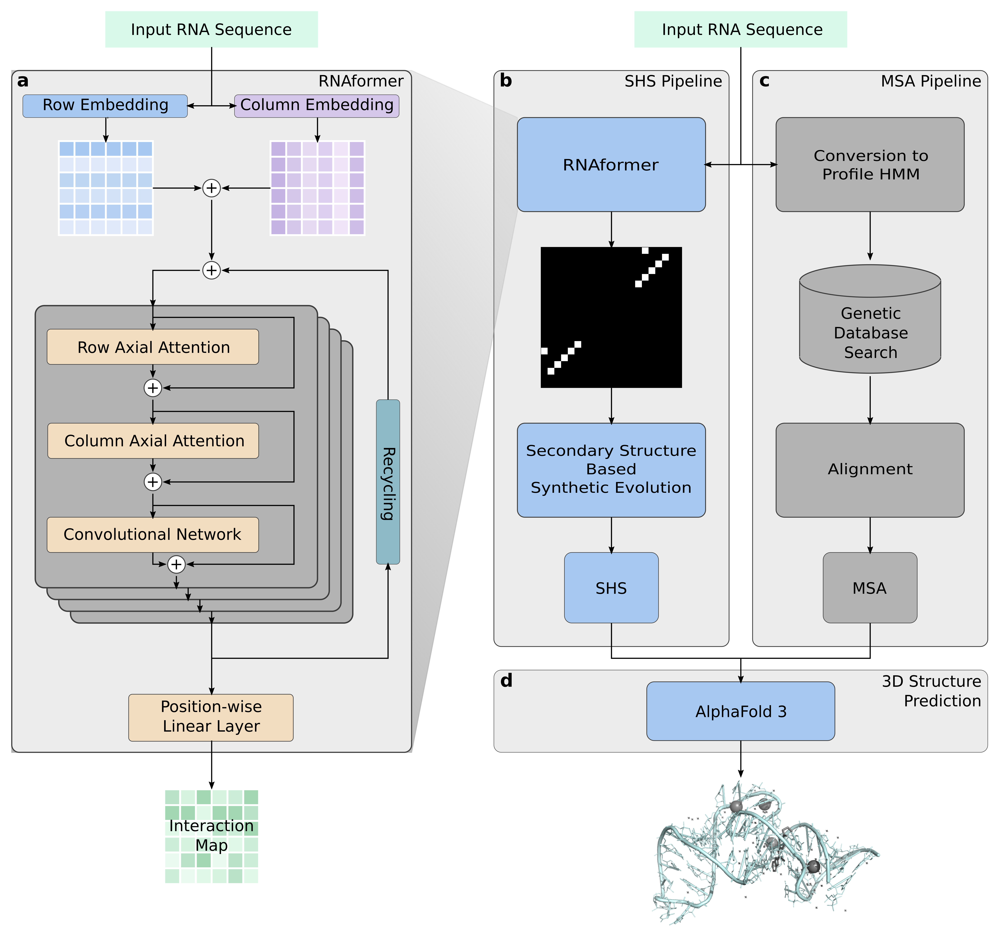

# SyntheticEvolution

Code for generating synthetic homologous sequences (SHS) of RNA from a predicted secondary structure, and for using them
as alignment input to AlphaFold 3.

This repository contains the code for the following papers:

* J. K. H. Franke\*, I. K. Tennie\*, M. Uhl, R. Köksal, D. Matus, D. Scheuer, F. Hutter, R. Backofen, F. Runge.
  *Encoding RNA Topology into Synthetic Alignments for 3D Structure Prediction.* NeurIPS 2026.
  The code and data to reproduce this paper are on the
  [`reproduce-neurips`](https://github.com/automl/SyntheticEvolution/tree/reproduce-neurips) branch.
* J. K. H. Franke\*, I. K. Tennie\*, M. Uhl, R. Köksal, D. Matus, F. Hutter, R. Backofen, F. Runge.
  *Synthetic RNA Evolution Enables Accurate Alignment-Free 3D Structure Prediction.* GEM Workshop at ICLR 2026.
  [OpenReview](https://openreview.net/forum?id=wWKuI35OW7)

\* Equal contribution.

The 3D evaluation of the NeurIPS paper uses an early version of the pipeline described in
I. K. Tennie, M. Uhl, J. K. H. Franke, R. Backofen, F. Runge. *AlphaFold 3 Prediction Accuracy and Reliability across
RNA Structures and Protein-RNA Interfaces.* bioRxiv 2026, [doi:10.64898/2026.11.02.763690](https://doi.org/10.64898/2026.11.02.763690).
The full version is at [automl/RNA-Protein-3D-Structure-Evaluation](https://github.com/automl/RNA-Protein-3D-Structure-Evaluation).
RNAformer is at [automl/RNAformer](https://github.com/automl/RNAformer).

## Abstract

Modern 3D structure predictors rely on multiple sequence alignments (MSA) to expose evolutionary covariation, but for RNA
those alignments are often missing, shallow, or unreliable. To overcome this limitation, we invert the co-evolutionary
structure inference pipeline and encode a predicted 2D topology into synthetic alignment-form covariation, without
database search or alignment steps. We introduce RNAformer, a transformer-based RNA secondary structure predictor that
supplies the topology, and a Synthetic Co-evolution Engine (SCE) that encodes it into synthetic homologous sequences
(SHS) by co-mutating paired positions.
Comprehensive experiments and systematic interventions across two structure predictors show that the MSA input acts as a
topology channel: equal-depth shuffled and random controls show that the encoded topology, not alignment depth, drives
the response; interventions on the encoded topology steer the predicted 3D structure; and with reference topologies the
effect persists for RNAs longer than 200 nucleotides. Natural MSAs remain the strongest input where homologs exist. On
single-chain RNAs, RNAformer-seeded SHS significantly improve over a no-alignment baseline and match natural MSAs when the
predicted 3D structure forms the encoded base pairs, a check that requires no ground truth. SHS are interpretable, fast,
and require no database search.


**RNAformer network architecture and workflow for the generation of synthetic homologous sequences.** **a,** *After embedding the input RNA sequence into a 2D latent representation, the RNAformer successively refines this internal representation in subsequent blocks leveraging axial attention layers to finally predict a full nucleotide interaction map.* **b,** *The synthetic homologous sequences (SHS) generation pipeline uses RNAformer to predict an interaction map. The interaction information is subsequently used to inform the generation of SHS.* **c,** *For comparison with our novel SHS approach, we show a (non-iterative) standard pipeline for obtaining MSA using a profile HMM for database mining and subsequent sequence alignment as e.g. used in the HMMER-based genetic search of AlphaFold 3.* **d,** *The generated set of SHS (or the obtained MSA in the case of vanilla AlphaFold 3 predictions) serves as the interaction information for 3D Structure prediction of AlphaFold 3.*

## Install
We use [miniconda](https://www.anaconda.com/docs/getting-started/miniconda/main)/[Micromamba](https://mamba.readthedocs.io/en/latest/installation/micromamba-installation.html) to create a virtual environment for all our dependencies. If you are not familiar with using ```conda``` or ```mamba``` please find more information at <https://www.anaconda.com/docs/getting-started/miniconda/main> and <https://mamba.readthedocs.io/en/latest/index.html>. You can download miniconda for Linux, Windows, and MAC [here](https://www.anaconda.com/download) or read about Micromamba installation [here](https://mamba.readthedocs.io/en/latest/installation/micromamba-installation.html).

Please find detailed guidelines for installation of our pipeline for the generation of synthetic homologues in our [Install Guidelines](/docs/INSTALL.md). 
For quick install, you can use our installation script by running 
```
./install.sh
```
This will install all requirements for the synthetic MSA genration, including downloading RnaBench and SPOT-RNA for structure predictions with SPOT-RNA and RNAfold.
The install script was tested on ```Ubuntu 22.04.5 LTS (Jammy Jellyfish)```.

**Note: Our full prediction pipeline requires AlphaFold 3.**
You can find more guidelines for installation in our [Install Guidelines](/docs/INSTALL.md).

## Data
**Note: Our SHS pipeline works with any AlphaFold 3 json input (data) file for the standalone code version. The AlphaFold 3 server currently does not support custom MSA inputs.**

The downloads below belong to the GEM workshop paper. For the NeurIPS 2026 paper, use the downloads listed on the [`reproduce-neurips`](https://github.com/automl/SyntheticEvolution/tree/reproduce-neurips) branch.

For reproducing the analysis of the workshop paper, we provide all predictions, data files, and processed results for download from stable URLs.

You can download all required files by running
```
./download.sh
```
This will download all data files, predictions, and evaluation ```.csv``` files to reproduce the results of the workshop paper.
**NOTE: The data files archive download is roughly 15GB and extracts to over 50GB.**

Alternatively, directly download all predictions, datafiles, and evaluations manually from
```
https://ml.informatik.uni-freiburg.de/research-artifacts/SyntheticEvolution/data.tar.gz
https://ml.informatik.uni-freiburg.de/research-artifacts/SyntheticEvolution/predictions.tar.gz
https://ml.informatik.uni-freiburg.de/research-artifacts/SyntheticEvolution/results.tar.gz
https://ml.informatik.uni-freiburg.de/research-artifacts/SyntheticEvolution/dssr.tar.gz
https://ml.informatik.uni-freiburg.de/research-artifacts/SyntheticEvolution/rnaformer_models.tar.gz
```
and extract them with
```
tar -xzvf <name>.tar.gz
```
Afterwards move them to the correct directories as follows
1. ```predictions``` to ```evaluation```
2. ```dssr``` to ```evaluation```
3. ```models``` (from ```rnaformer_models.tar.gz```) to ```RNAformer```

After this, you should be ready to go.

## Usage
Please find detailed usage instructions in our [Usage Guidelines](docs/USAGE.md).
